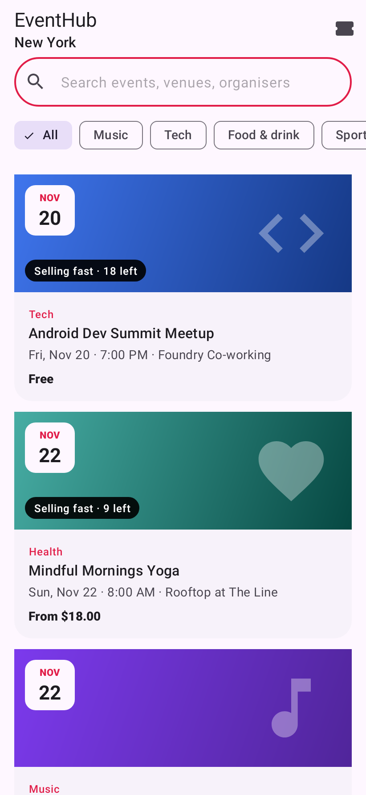
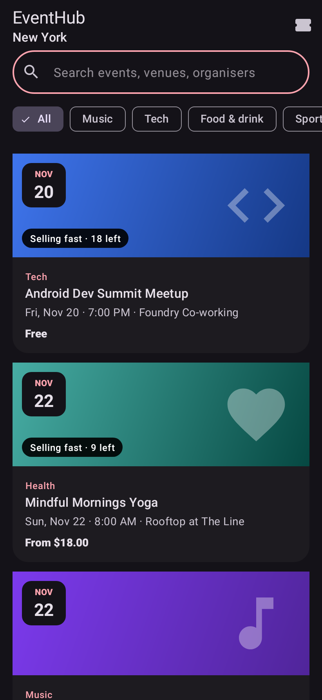
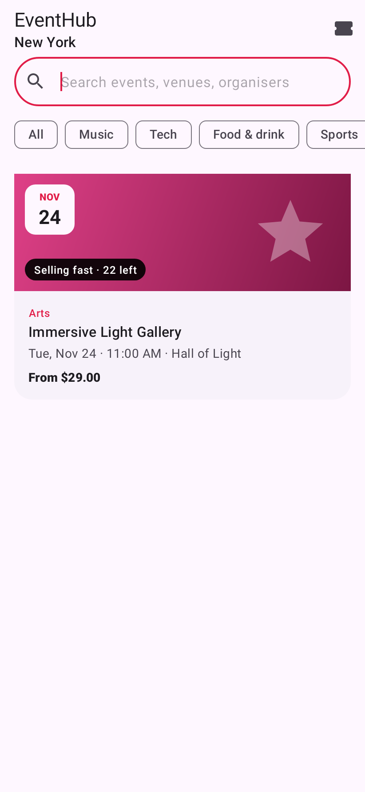
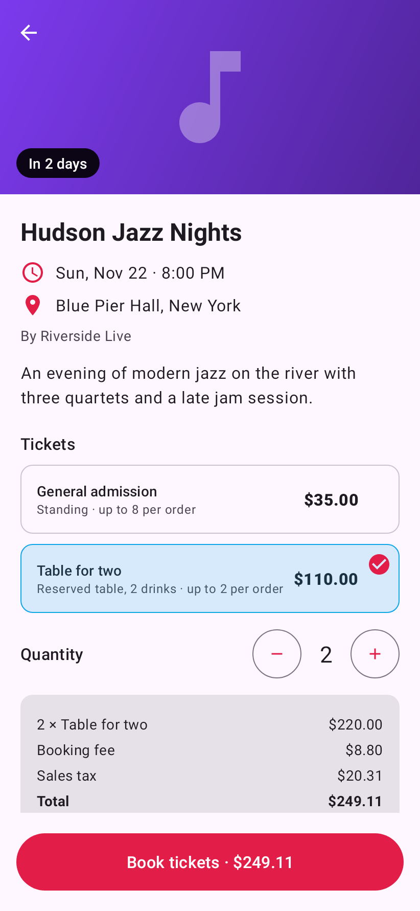
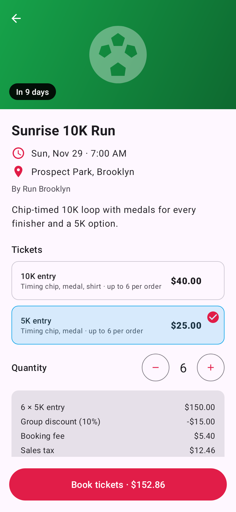
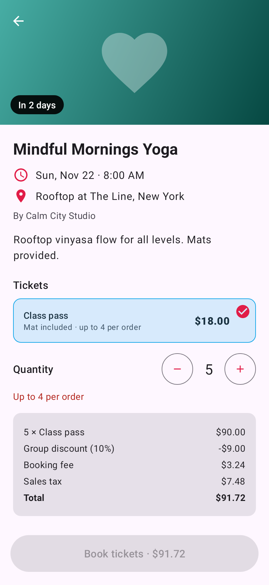
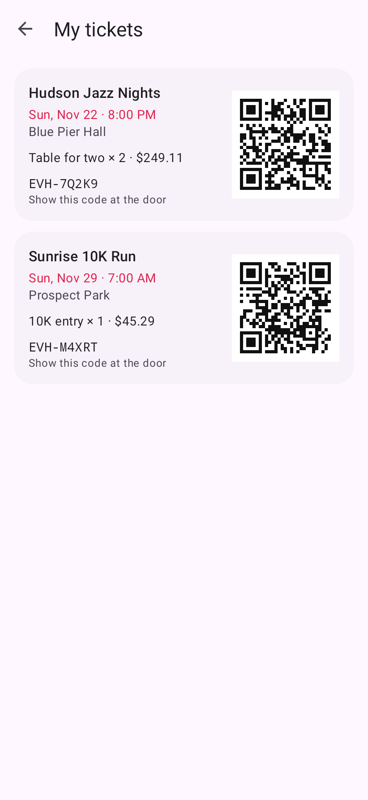

# EventHub · event discovery & ticketing (Java)

[](https://github.com/gayatripatel10091992/java-eventhub/actions/workflows/ci.yml)


Browse local events, filter by category and date, pick a ticket tier and quantity, book, and show a QR ticket at
the door, even offline. Written in **Java** with XML layouts, the way most production Android apps were built
when I started at Fusion Informatics (event-management, healthcare and logistics apps with REST APIs).
It uses current AndroidX libraries.

> Portfolio project. Original code; events, venues and organisers are fictional.

## Screenshots

Rendered on the JVM by Robolectric (native graphics) in CI, from the real activities and XML layouts.

| Events | Dark theme | Filtered: Arts | Pick a tier |
|---|---|---|---|
|  |  |  |  |

| Group discount (6 tickets) | Per-order limit | My tickets with QR |
|---|---|---|
|  |  |  |

## What's inside

| Area | Implementation |
|---|---|
| **Architecture** | MVVM with AndroidX `ViewModel` + `LiveData` (`MediatorLiveData` to combine data and filters), a repository, and a small `ServiceLocator` for DI that tests override. |
| **Networking** | Retrofit 2 + Gson + OkHttp. `MockApiInterceptor` serves the API inside OkHttp, so the full stack (serialisation, HTTP codes, error bodies) runs without a server. Swap it out to hit a real backend. |
| **Persistence** | Room stores booked tickets, so they open offline at the venue. Writes happen on a background executor. |
| **Pricing** | `OrderCalculator`: per-order limits, remaining stock, 10% group discount from 5 tickets, booking fee with a minimum, sales tax. Validated in the app and again by the API. |
| **Tickets** | QR codes generated with ZXing; the payload carries a CRC so a damaged or edited code is rejected offline (`CheckInCode`). Bitmaps are cached in a byte-sized `LruCache`. |
| **UI** | Material 3 Views: `CoordinatorLayout` app bar that scrolls away, `ChipGroup` filters, `SwipeRefreshLayout`, `ListAdapter` + `DiffUtil`, checkable `MaterialCardView` tiers, View Binding, DayNight theme. |
| **Tests** | 7 JUnit tests on the pure-Java `core` module (filters, weekends, pricing, check-in codes) and 7 Robolectric screenshot tests driving real activities. |

```
core/   pure Java: Event, TicketTier, OrderCalculator, EventFilter, DateLabels, CheckInCode
app/    data/  EventApi (Retrofit) · MockApiInterceptor · AppDatabase/TicketDao (Room) · DefaultEventRepository
        ui/    EventListActivity · EventDetailActivity · TicketsActivity · ViewModels · adapters
```

## Build

```bash
./gradlew :core:test              # pure Java logic
./gradlew :app:testDebugUnitTest  # Robolectric UI tests, writes app/build/outputs/screenshots
./gradlew assembleDebug
```

## License

MIT
